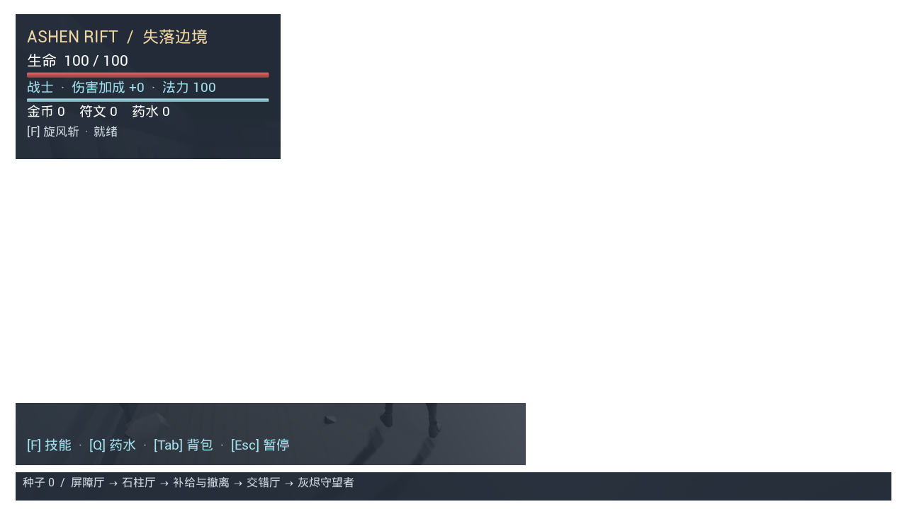
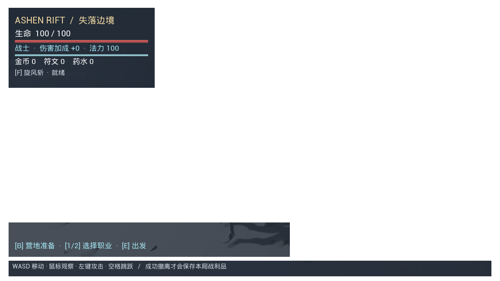

# 0.9 组员地图整合

日期：2026-11-06（Asia/Shanghai）。引擎保持 Unreal Engine 4.27.2，采用 C++ 核心与蓝图布局。

## 来源与保留范围

- 组员：Kuangxin。
- 来源仓库：[kuangxin114514/Ashen-Rift-The-Lost-Frontier](https://github.com/kuangxin114514/Ashen-Rift-The-Lost-Frontier)。
- 固定来源提交：[e2dfc0b83847e912f477b9bc0ecd9c0046c2f729](https://github.com/kuangxin114514/Ashen-Rift-The-Lost-Frontier/commit/e2dfc0b83847e912f477b9bc0ecd9c0046c2f729)。
- 导入 `Content/AshenRift/KayKit/` 的 215 个资源包，以及 `BP_Room_Pillars`、`BP_Room_Barricade`、`BP_Room_Cross`、`BP_Camp`。
- 三个战斗房间分别保留组员手工调整的 4、5、6 个网格组件；营地保留 20 个网格组件。没有使用入门生成脚本替换这些布局。
- 原始地图经 UE4 的 **Save Map As** 保存为 `/Game/AshenRift/Maps/L_FrontierDungeon`，随后以同一资产路径导入主项目。没有通过文件系统更名 Unreal 包。
- 本地 `L_RandomDungeon` 与更早关卡保留。整合前后的 `L_RandomDungeon.umap` SHA256 为 `972F4401F7E07254BA8EEFE09B4146E48C63A1FD134BFBE1ABB79F5A8084739A`。
- 组员仓库的个人路径、工具链配置、README 和其他同名玩法文件没有整体覆盖主项目。

KayKit 环境资产作者为 Kay Lousberg，来源及 CC0 许可说明见 [第三方资产记录](ThirdPartyAssets.md)。地图编排与现有玩法整合分别记录贡献，不将素材包记为团队原创美术。

## 接入现有玩法

默认启动地图、试玩脚本与地图烘焙清单已加入 `L_FrontierDungeon`。原地图仍可单独打开。

`AARDungeonDirector` 接受可编辑的 `RoomLayouts` 类列表；使用相同种子，在固定的三个战斗区域中选择不重复的布局。新增布局会改变随机池与种子映射，保持列表顺序才能复现同一版本的布局。主路线仍固定，不是随机分支迷宫。

组员地图中的 `CampLayout` 原来没有保存绑定，本次明确指向 `BP_Camp`。营地在开始游戏时生成；撤离或死亡返回营地后复用同一实例，不会重复堆叠摆设。旧地图不绑定此字段时维持原有行为。空或不足三个条目的战斗布局池使用原生灰盒布局补足三个战斗区域。

玩家职业、战斗、敌人、掉落、装备、商店、仓库、永久天赋和结算继续使用主项目已有逻辑。存档槽和存档版本未改变。

## 整合修正

- 将运行时房间显示与编辑器 Actor 标签分离，避免 Game 目标引用仅编辑器可用的接口。
- 入门蓝图创建接口和脚本拒绝覆盖现有资产，保护组员手工编辑内容。
- 营地出口原网格包含关闭的木门。替换为同素材包真正开放的 `wall_doorway_sides` 门框；保留其余环境编排。
- 拱门局部 X 比例至少 1.4、Z 比例至少 1.5，开放脚手架 Z 比例至少 1.2，匹配已有共享 NavMesh 的 72 cm 半径、300 cm 净空与网格侵蚀余量（Boss 胶囊总高 288 cm）。
- 第三道门旁已打开的装饰木门使用 `NoCollision`，防止门板侵入通道并阻挡玩家与导航。
- 清除开放门框与脚手架的旧简化碰撞，重建导航几何缓存，避免视觉上开放但导航仍被实心凸包阻挡。
- 所有门框保留按真实三角面计算的碰撞。没有关闭整张地图碰撞或绕过导航来掩盖不通问题。
- 原远程敌人测试的 +Y 闪避位置会进入新增商店掩体，UI 暂停测试的临时敌人位置也与新增摆设冲突。本次将测试位置移到空旷一侧；保留原伤害、弹体、暂停和视线规则，未修改 AI 以迎合测试。

## 验证

2026-11-06 最终结果：

| 检查 | 结果 | 本地证据（`Saved` 不上传） |
|---|---|---|
| Development Editor 编译 | 通过 | `Saved/build_team_map_editor.log` |
| Development Game 编译 | 通过 | `Saved/build_team_map_game.log` |
| 项目蓝图编译 | 0 errors、0 warnings、0 load failures | `Saved/compile_team_map_blueprints.log` |
| 默认回归配置 | 11 项通过，0 失败、0 警告 | `Saved/TestReport_L_FrontierDungeon_*/index.json` |
| 原灰盒回归配置 | 10 项通过，0 失败、0 警告 | `Saved/TestReport_L_RandomDungeon_*/index.json` |
| 新地图真实 GPU 复验 | TeamMap 通过，0 失败、0 警告；1280 × 720 | `Saved/TeamMapRendered/index.json` |
| 文档与资产保留 | README 结构、命令、相对链接和图片通过检查；旧图和四个手工预制体哈希一致 | `Data/TeamMapProvenance.json`、`Saved/validate_integration_docs.py` |

默认回归配置为三项 Core 和八项 Integration，旧图配置为三项 Core 和七项 Integration；部分用例在两套配置中重复执行，共 11 种测试用例。两套配置中的 RunLoop 和 Progression 分别使用历史的 `L_FirstPlayable` 和 `L_Progression`，其余地牢集成测试使用所选地图。

首次回归明确发现了闭门网格、装饰门板、导航净空以及旧测试场景坐标冲突；修正后全部必要检查通过。默认套件分阶段执行，使用 `-Only` 继续验证修正后的或尚未执行的套件；最终逐套报告均通过。

测试通过 `-ARTestProfile` 使用独立 GUID 存档，不读取或消耗玩家真实余额与仓库。

`Integration.TeamMap` 检查：四个组员预制体依赖、营地出生点净空、五道门的玩家胶囊通行、六种布局排列的全路径、营地复用、撤离入库和第二局死亡损失。

## 后续编辑与限制

1. 打开 `L_FrontierDungeon`，在 `RandomRoomDirector` 中检查 `Room Layouts` 与 `Camp Layout`。
2. 打开 `AshenRift/Rooms` 下对应蓝图的 Viewport，移动组件后 Compile、Save。
3. 更名或复制资产使用 Content Browser；不要直接更名 `.uasset` 或 `.umap` 文件。
4. 运行 `Tools/TestPrototype.ps1` 检查新地图。旧图回归可指定 `-DungeonMap /Game/AshenRift/Maps/L_RandomDungeon`。

环境仍含支撑地板和少量灰盒几何体，角色与武器仍为模板／简易外观，部分场景标牌为英文。地图内的金币、木箱、宝箱等装饰网格不会自动成为可拾取物、可破坏物或仓库交互点。后续新增场景互动需要另行接入玩法。

本次不代表最终美术验收、性能基准或 Windows 打包验收。完整分辨率测试、音频混音、精修动画与更广泛玩家试玩仍待完成。

以上截图来自隔离存档的 GPU 验证，地牢敌人已为导航检查清除。四个手工预制体的保留哈希见 [整合来源记录](../Data/TeamMapProvenance.json)。
