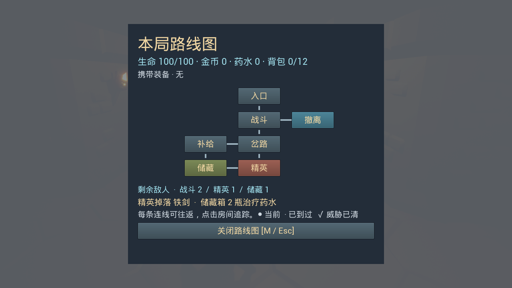

# 0.14 储藏室与路线状态

2026-11-26 · Unreal Engine 4.27.2 · Windows Development

地牢三的模块化支路加入了第七个房间。储藏室的一侧通向精英房，另一侧按本局种子连接补给房或撤离房。新门洞形成一条可往返的环路，玩家能够沿原路回撤，也能抄近路去补给或撤离。

进入地牢三后，在路线牌旁按 **E**，再按 **4** 预览支路。进入绿色传送点后，按 **M** 打开地图。**●** 表示当前房间，**·** 表示到过，**✓** 表示这一组敌人已被清理。地图会显示战斗大厅、精英房和储藏室各自剩下的敌人，以及宝箱奖励和领取状态。

击败储藏室守卫后靠近宝箱按 **E**。奖励是两瓶治疗药水或两枚符文，种子在进入支路前就已决定。药水叠加空间不足时可以稍后再领，领取成功后原路离开并再次进入也会保留宝箱状态。领取的奖励随本局战利品一起结算。

支路保留了已有地牢三资源、摆位和存档格式。旧版地图实例在载入时会补上第七个房间预设，可继续在 `ExpeditionBranchWing` 的编辑器属性里调整道具与灯光。

## 验证

| 验证项目 | 结果与本地记录 |
|---|---|
| 完整回归 | 14 项通过，覆盖经典模式、三张手工地牢、升档和生成式支路。见 `Saved/test_v014_full.log`。 |
| 布局与路线 | 128 组规划种子检查复现性与连通性。种子 4、9、15、28、29 在 UE4 中覆盖四种连接方式，验证了全部房间的门洞碰撞、导航和回撤。种子 9 使用实际渲染。 |
| 储藏箱与结算 | 药水和符文均可正常领取和撤离入库。守卫存活时无法领取，药水叠加空间不足时保留整份奖励，重复按键和离开后再进入均不会重置宝箱。 |
| 构建与资源 | Development Editor 与 Game 均构建通过。蓝图编译和六张地图的 WindowsNoEditor 烘焙均为 0 错误、0 警告。见 `Saved/compile_v014_blueprints.log` 与 `Saved/cook_v014.log`。 |
