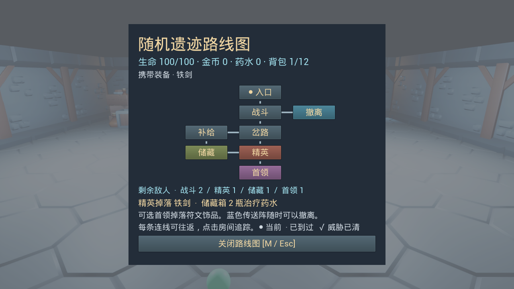

# 0.15 随机遗迹

2026-11-26 · Unreal Engine 4.27.2 · Windows Development

在主城出生点附近按 **B**，选择已经解锁的难度档，再点 **随机遗迹**。进入后按 **M** 打开路线图，点选房间可在 HUD 上追踪目的地。

每局生成八个相连的房间。补给房有商人，储藏室宝箱由守卫看管。精英房后可以挑战灰烬守望者，击败后可拾取符文饰品。路线图会提示各房剩余敌人，并标记当前房间、到访和清理状态。

带着已有战利品走到蓝色传送阵，按 **E** 并在阵内停留三秒即可撤离。也可以选择在商店补给，绕去储藏室或首领房争取额外奖励。最高已解锁档成功撤离可继续升档，共三档。死亡会损失携带物品和本局收获，已存入仓库的物品、货币和已解锁档位会保留。

**随机出征**仍从三张手工地牢中抽取。地牢三的七房间支路可通过原来的路线牌进入。随机遗迹使用独立地图 `/Game/AshenRift/Maps/Map_RandomRuins`，运行时按种子组装房间并生成导航。房间装饰和照明可在场景里的 `ExpeditionBranchWing` 属性中调整。

## 验证

| 验证项目 | 结果与本地记录 |
|---|---|
| 完整回归 | 15 项通过，覆盖经典模式、手工地牢、地牢三支路和随机遗迹。见 `Saved/test_v015_full.log`。 |
| 地图生成 | 128 个种子检查了布局复现性、房间重叠和首领房分支。种子 9、28 在引擎中验证了各房间通向撤离点的导航、首领房门洞和从首领房回撤的路径。 |
| 出征与结算 | 通过主城入口携装出发，验证了绕过首领撤离、击败首领后带着饰品撤离、升档，以及死亡后回城并保留已存奖励和档位。见 `Saved/test_v015_ruins.log`。 |
| 实机渲染 | 种子 9 在 1280 × 720 的独立窗口跑通。上图来自 UE4.27.2 实机。见 `Saved/test_v015_rendered.log`。 |
| 构建与资源 | Development Editor 和 Game 构建通过。蓝图编译与七张地图的 WindowsNoEditor 烘焙报告 0 错误和 0 警告。见 `Saved/compile_v015_blueprints.log` 和 `Saved/cook_v015.log`。 |
