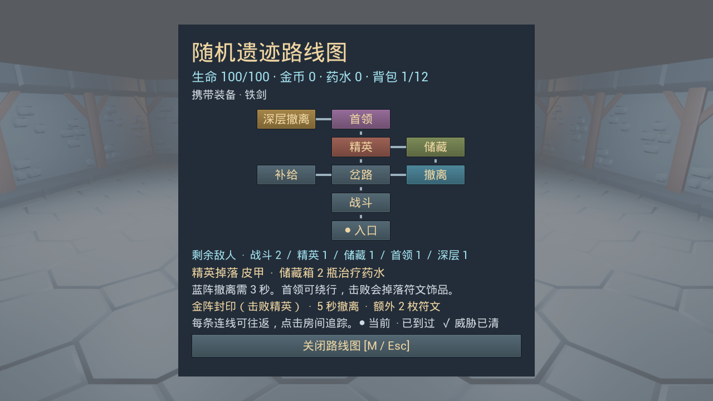

# 0.16 深层撤离

2026-11-27 · Unreal Engine 4.27.2 · Windows Development

在主城按 **B**，选难度并点击 **随机遗迹**。进入后按 **M** 查看本局九个房间。点击「撤离」或「深层撤离」，可在 HUD 上追踪相应传送阵。

| 路线 | 开启条件 | 按 E 后停留时间 | 额外符文 |
|---|---|---|---|
| 蓝色传送阵 | 到达撤离房 | 3 秒 | 0 |
| 金色传送阵 | 击败精英并穿过首领房 | 5 秒 | 一档 2 枚，二档 3 枚，三档 4 枚 |

深层撤离房还有一名远程敌人。玩家可以绕过灰烬守望者，也可以挑战它来争取符文饰品。路线图会显示金阵的封印状态、奖励预览和深层房剩余的敌人。

撤离读条期间离开传送阵或受伤都会中断。完成金阵读条后，额外符文随战利品一起写入存档，并在结算页单独显示。两种路线都沿用原有升档条件，成功从最高已解锁难度撤离即可开启下一档。

## 验证

| 项目 | 验证内容 |
|---|---|
| 完整回归 | 15 项通过，覆盖手工地牢、地牢三支路和随机遗迹双撤离。见 `Saved/test_v016_full.log`。 |
| 房间与导航 | 检查 128 个布局种子的房间重叠、复现性和深层房连接。种子 9、28 在 UE4 中检查了两扇首领房门洞、各房间通向蓝阵的导航，以及击败首领后步行回撤。 |
| 撤离与存档 | 验证了金阵解封、按档预览 2／3／4 枚符文、离开及受伤中断、改走蓝阵、首领存活时完成金阵撤离，以及读条中死亡。隔离存档重新载入后，额外符文只记入一次。 |
| 实机路线图 | 种子 28 在 1280 × 720 的 UE4.27.2 独立窗口运行。见 `Saved/test_v016_rendered.log`。 |
| 构建与地图 | Development Editor 和 Game 构建通过。蓝图编译与七张地图的 WindowsNoEditor 烘焙均报告 0 错误、0 警告。 |
