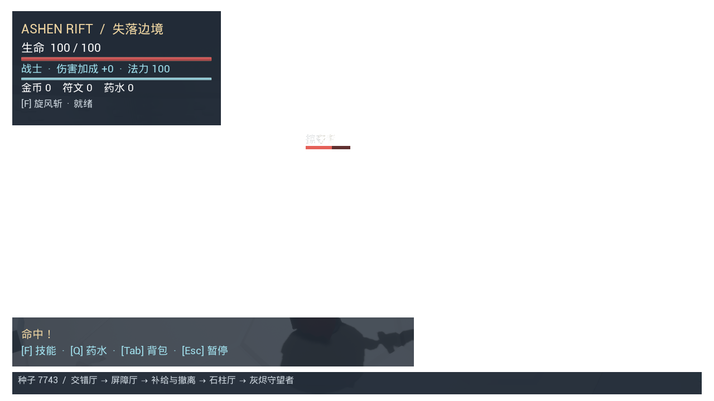
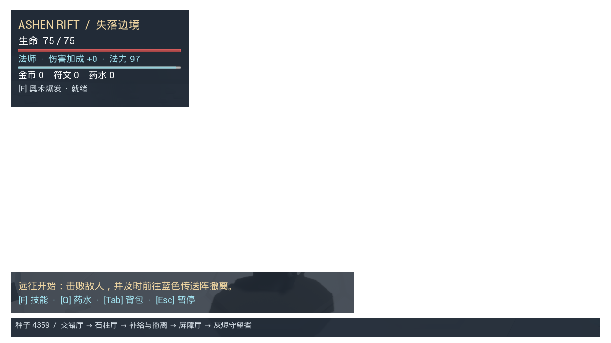

# 0.17 角色与战斗动画整合

2026-11-28 · Unreal Engine 4.27.2 · Windows Development

在主菜单或主城营地准备面板选择战士或法师，回到游戏画面就能看到各自的模型。进入手工地牢或随机遗迹后，**鼠标左键**和 **F** 分别触发普攻与职业技能。

- 战士使用骑士模型，支持横斩、旋风斩、跑步、起跳、滞空、落地、受击和倒地。
- 法师使用独立模型，支持短咒弹体、奥术爆发，以及自己的移动、跳跃、受击和倒地动作。
- 掠夺者使用下劈与横挥，术士使用施法，精英守卫使用随左前臂运动的盾击。灰烬守望者有横扫、肘击、范围砸地与跪倒动作。

玩家普攻和技能在动作播放到指定进度时结算，攻击方向以起手时的视角为准。受击可打断起手，法术释放时扣除法力。敌人攻击按预警时间结算，倒地时立即停止战斗并生成掉落。

地图按敌人的生命状态标记清理，击败守卫即开放宝箱，击败随机遗迹的精英即解封金阵。这样敌人的倒地动画可以继续播放，战利品与撤离条件会立即更新。

模型和动作由组员 byimy 整合提交。角色资源来自 Kay Lousberg 的 KayKit Adventurers，采用 CC0 1.0。 [组员源提交](https://github.com/byimy/Ashen-Rift-The-Lost-Frontier/commit/498b93bceada451a18bcf8a31f465c30785c9003) · [资产与许可](ThirdPartyAssets.md)

## 验证

| 项目 | 结果 |
|---|---|
| 完整回归 | 15 项通过，覆盖职业、营地、背包、手工地牢和随机遗迹。见 `Saved/test_v017_full.log`。 |
| 玩家动作 | 在 UE4 核对两个模型和挂点、跳跃阶段及姿势过渡、横斩命中、旋风斩、短咒和奥术爆发的单次释放，以及受击和暂停表现。见 `Saved/test_v017_rendered_CombatFeedback.log`。 |
| 敌人动作 | 核对掠夺者交替攻击、精英盾击与盾牌跟随、灰烬守望者三种攻击、死亡动作和一次性掉落。见 `Saved/test_v017_rendered_EnemyVariants.log`。 |
| 路线与撤离 | 专项测试通过，覆盖储藏箱清敌提示、地牢三路线、随机遗迹九房间和双撤离。见 `Saved/test_v017_targeted.log`。 |
| 构建与资源 | Development Editor、Game 编译通过。蓝图和七张地图的 WindowsNoEditor 烘焙均为 0 错误、0 警告。组员交付的 36 个 UE 资源包与源提交逐一比对，全部进入烘焙产物。 |

仍依赖同帧伤害断言的旧测试通过隔离存档参数运行旧战斗路径。战斗反馈、敌人动作和出征路线专项使用正常的新战斗路径。
