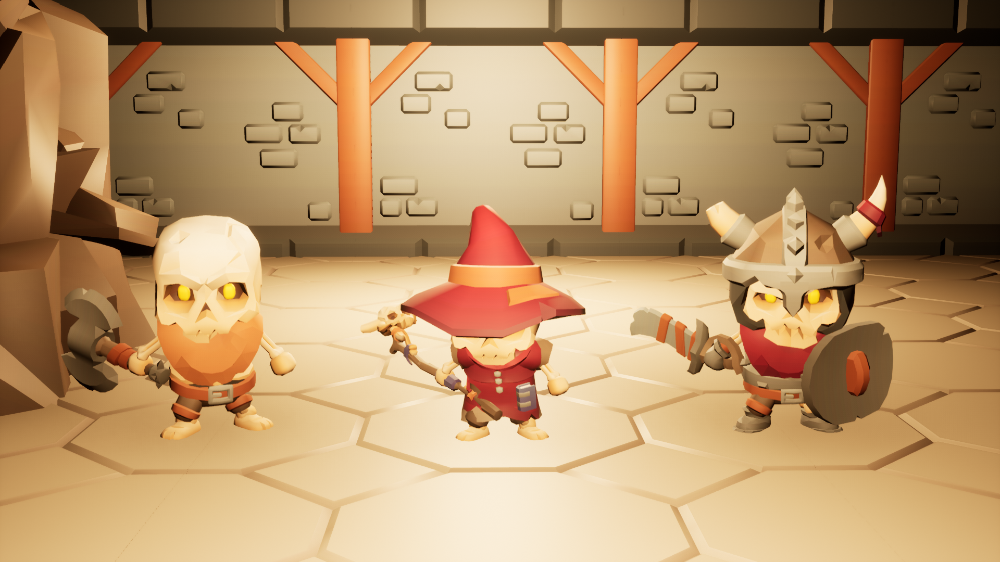
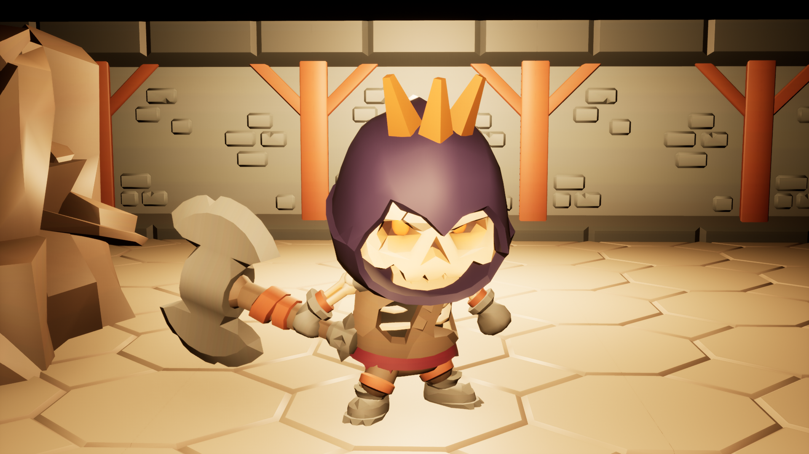

# 0.20 敌人和灰烬守望者外观

2026-11-28 · Unreal Engine 4.27.2 · Windows Development

本版把四种敌人的造型和武器接入现有敌人类。普通敌人共用一套 KayKit 骨架和倒地动作，灰烬守望者有自己的造型和倒地动作。命中、弹体、碰撞和掉落仍由原有游戏逻辑处理。

| 敌人 | 模型与装备 | 主要战斗动作 |
|---|---|---|
| 掠夺者 | Skeleton Minion + 骨斧 | 下劈、横斩 |
| 术士 | Skeleton Mage + 法杖 | 抬杖施法 |
| 精英守卫 | Skeleton Warrior + 剑盾 | 持盾进攻 |
| 灰烬守望者 | Skeleton Rogue + 深色兜帽和披肩、三尖王冠、琥珀眼光和巨斧 | 砸地、横扫、近身重击 |

从主城营地选择「随机遗迹」，入口战斗房可见术士，深处路线有精英守卫，首领房可挑战灰烬守望者。地牢地图上的同类敌人也按对应 C++ 敌人类加载造型。





以上两张是游戏在随机遗迹中的造型展示，使用隐藏 HUD 的独立镜头，原图分辨率为 1920 × 1080。

## 资产来源与维护

- 作者 Kay Lousberg。UE 资产保存在 `Content/AshenRift/Enemies/KayKit/`。导入使用作者官方公开 1.0 仓库的固定提交，包含四份 glTF、对应武器和纹理。 [素材发布页](https://kaylousberg.itch.io/kaykit-skeletons) · [固定源版本](https://github.com/KayKit-Game-Assets/KayKit-Character-Pack-Skeletons-1.0/tree/15b62b9bad122f72926c10fb14d622c73819fa54) · [CC0 许可](https://github.com/KayKit-Game-Assets/KayKit-Character-Pack-Skeletons-1.0/blob/15b62b9bad122f72926c10fb14d622c73819fa54/LICENSE.txt)
- 将上述源码归档里的 `addons` 目录解压到项目的 `Saved/KayKitSkeletons020/`。通过 Blender 4.2 运行导出脚本，然后通过 UE4.27 Python Editor Script Plugin 执行导入脚本。脚本把武器绑定到手部骨骼，四个网格共用 `SK_Raider_Skeleton`。
- 试玩与构建直接使用仓库里的 UE 资产。只有重新导入模型时需要 Blender 和源文件。三个难度档位共用本版外观，敌人特效和音色仍可进一步区分。

```powershell
& $blenderExe --background --factory-startup --python Scripts/export_kaykit_enemies.py -- Saved/KayKitSkeletons020/addons/kaykit_character_pack_skeletons Saved/KayKitSkeletons020/FBX
& $ueEditorCmd "$PWD/AshenRift.uproject" "-ExecutePythonScript=$PWD/Scripts/import_kaykit_enemies.py" -unattended -nop4 -nullrhi
```
