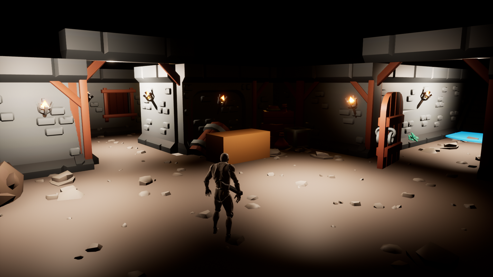
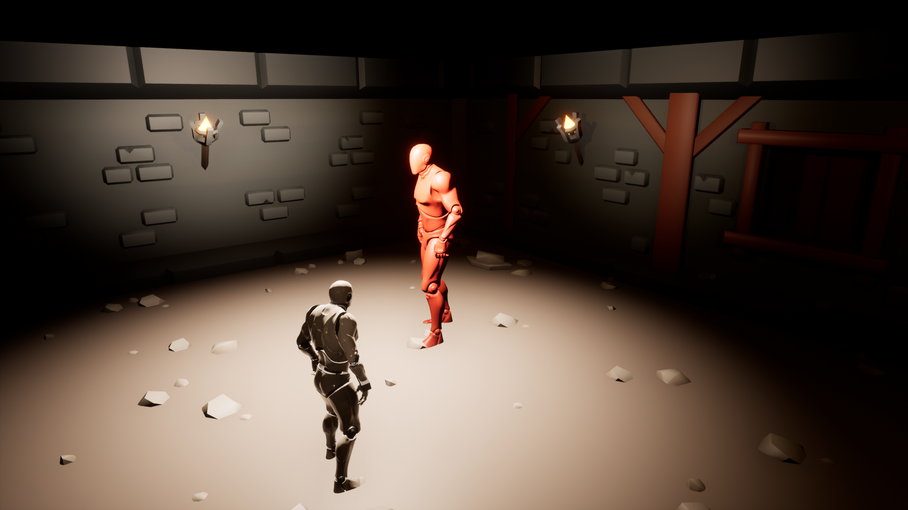

# Ashen Rift: The Lost Frontier

English | [简体中文](README.zh-CN.md)

A single-player action RPG prototype built with **Unreal Engine 4.27.2, C++ and Blueprints**. Explore dungeons, collect loot, buy supplies, and choose between extracting safely or pushing deeper for greater rewards and permanent progression.

**Version:** 0.14 · **Platform:** Windows · **Interface:** Chinese · **Status:** Playable prototype with seeded expeditions and a modular branch in Dungeon 3

[Changelog](CHANGELOG.md) · [Development notes](#development-notes)


## The central decision

Every run asks how much you are willing to risk. Start a random expedition from town or choose a dungeon for practice. Spending run gold on potions and temporary damage upgrades can improve your chances against later enemies, but leaves less gold to extract. You can return to the extraction portal to save your loot or press on toward the elite and the Ashen Warden for more rewards.

Successful extraction stores remaining items and currency. Runes purchase permanent talents, and stored equipment can be taken into later runs. Bringing stronger gear helps you fight, but that gear is also lost if you die before extracting. Uncarried stash items, banked currency and purchased talents remain safe.

```text
Town preparation → Random expedition or manual dungeon → Explore and collect loot
                                                          ├─ Supplies or elite → Continue exploring
                                                          └─ Extract → Save loot → Return to town
```

## Features

- **Two classes:** a melee Warrior with Whirlwind and a ranged Mage with mana-based spells and Arcane Burst.
- **Three enemy types and one Boss:** Raiders, projectile-firing Hexers, heavy-attacking Sentinels and the Ashen Warden, with readable attack warnings and opportunities to dodge or use cover.
- **Town and three expeditions:** Choose one of Kuangxin's hand-authored dungeons from the preparation panel. Dungeon 3 has a larger layout with separate merchant and Boss areas. Both areas can be visited within the same run, with the player's health, inventory and run currency carried through each passage.
- **Random expeditions and difficulty tiers:** A run seed selects the dungeon, enemy arrangement and equipment drops. Extraction at the highest unlocked tier opens the next of three tiers, with stronger enemies and better rewards.
- **Dungeon 3 route board:** Preview the merchant, a seeded elite encounter with a listed equipment drop, or a seeded extraction destination. The board displays health, potions, gold and carried gear. Selecting a route tracks it on the HUD.
- **Modular branch:** Preview seven interconnected rooms in Dungeon 3. The seed chooses how the rooms connect, and the dungeon assembles their doors and walkable floors on entry. The route map marks visited rooms and cleared threats and previews the elite drop and guarded storeroom reward.
- **Classic shuffled layouts:** the previous `L_FrontierDungeon` remains playable in Classic mode. Its three editable combat-room Blueprints, Pillars, Barricade and Cross, still change order according to the seed.
- **Equipment and economy:** weapon, armour and charm slots, drops, potions, limited shop stock and temporary damage upgrades.
- **Persistent progression:** shared Vitality and Might talents, item storage and camp loadout preparation.
- **Clickable Chinese UI:** main menu, camp, inventory, trader, pause and settlement screens, with keyboard shortcuts retained.
- **Combat feedback:** five basic skeletal overlay animations, hit flashes, sparks, actual damage numbers, light camera feedback and eleven originally synthesised sound effects.





*Version 0.10 screenshots captured in UE4.27.2 at 1920 × 1080 with the HUD hidden.*

## Requirements

The current Windows build targets explicitly select the following toolchain:

| Component | Version |
|---|---|
| Unreal Engine | 4.27.2 |
| Visual Studio Build Tools | 2019, with C++ build tools |
| MSVC | v142 |
| Windows SDK | 10.0.19041.0 |
| .NET Framework | 4.8 SDK and Targeting Pack |

Python Script Plugin and Editor Scripting Utilities are enabled for editor asset-generation tools. Gameplay does not require a separate Python installation.

## Build and play

Clone the project and open PowerShell in its root directory, which contains `AshenRift.uproject`:

```powershell
git clone https://github.com/Aprine/Ashen-Rift-The-Lost-Frontier.git
cd Ashen-Rift-The-Lost-Frontier
```

Set `$ueRoot` to your **Unreal Engine 4.27.2 installation directory**; the example uses the scripts' default path.

```powershell
$ueRoot = 'D:\Epic Games\UE_4.27'

# Build the editor module.
.\Tools\BuildProject.ps1 -EngineRoot $ueRoot

# Launch a standalone play window using the installed engine.
.\Tools\PlayPrototype.ps1 -EngineRoot $ueRoot
```

The default map is `/Game/AshenRift/Maps/Map_Hub`. Open the project in UE 4.27.2 to edit it, or use the standalone script above for cross-map gameplay. Pass `-Classic` to the play script to start `/Game/AshenRift/Maps/L_FrontierDungeon`. The earlier greybox remains available at `/Game/AshenRift/Maps/L_RandomDungeon`.

Choose a class in the main menu, enter town and press **B** near the spawn to prepare. Select an unlocked difficulty tier and choose **Random expedition** or press **E**. The three named dungeon buttons launch practice runs. In Dungeon 3, find the **route board**, press **E**, then press **4** to preview the modular branch. Select a room, follow the HUD to the green passage and press **E** to enter. Press **M** inside the branch to reopen the map. Press **R** at settlement to return to town.

The storeroom connects the elite room to either the merchant room or the exit. Defeat its guard and press **E** at the chest to claim two potions or two runes, as shown on the map.

To compile the Development game target:

```powershell
.\Tools\BuildProject.ps1 -EngineRoot $ueRoot -Game
```

The play script uses your local Unreal installation. The Development game executable is an uncooked build; a distributable Windows package has not yet been validated.

## Controls

| Action | Control |
|---|---|
| Move / look | WASD / mouse |
| Jump | Space |
| Basic attack / Mage projectile | Left mouse button |
| Class skill | F |
| Use a potion | Q |
| Interact, trade, view routes, start a random expedition or extract | E |
| Select an expedition tier or launch a practice dungeon | Difficulty or dungeon buttons in town preparation |
| Track supplies / elite / extraction | 1 / 2 / 3 or click the route board |
| Preview and track the modular branch | 4 on the route board, or M near the branch entrance and inside |
| Claim the guarded storeroom reward | E near the chest after defeating its guard |
| Open inventory | Tab |
| Equip or unequip weapon / armour / charm | Z / X / C |
| Open camp preparation | B, while near camp |
| Select Warrior / Mage | 1 / 2, in camp |
| Upgrade Vitality / Might | T / Y, in camp preparation |
| Select stash item / change carried quantity | Up and Down / Left and Right |
| Buy a potion / damage upgrade | 1 / 2, while trading |
| Return to camp or retry a pending save | R, on the result screen |
| Close a panel, or pause / resume | Esc |
| Toggle sound effects | Main-menu or pause-menu button |

Combat continues while the inventory, trader, route board or branch map is open. Opening a panel displays the cursor and blocks movement, camera and attack input. The dedicated pause menu freezes the game world, cooldowns and extraction progress.

In editor Play-in-Editor sessions, Esc may stop play instead of opening the pause menu. Use the standalone window to check pause behaviour; Shift + F1 releases the editor mouse cursor.

## Run and progression rules

- **Extraction:** remain in the blue portal for three seconds. Taking damage or leaving cancels the attempt. Defeating the Boss is optional.
- **Expedition tiers:** only a successful random expedition at your highest unlocked tier opens the next tier. A newly unlocked tier is automatically selected for the next departure. Death leaves unlocked tiers available.
- **Death:** carried items, new loot and unextracted currency are lost. Uncarried stash stock, banked currency and permanent talents remain.
- **Loadouts:** bring at most one of each equipment type and five potions, with a weapon matching your class. Stock is deducted and saved at departure, not while preparing. Selected equipment is automatically equipped on entry.
- **Talents:** Vitality adds maximum health and Might adds damage. Both have three ranks, are shared by the classes and cost banked runes.
- **Currencies:** dungeon shops spend run gold. Banked gold is currently recorded and displayed; permanent upgrades use runes.
- **Settlement:** successful extraction stores remaining carried items and new loot together. Consumed potions are not returned, and repeated settlement requests cannot duplicate rewards.

## Validation

The suite covers health, inventory, room seeds, the run loop, progression, dungeon navigation, camp management, enemy variants, UI, combat feedback, all three expeditions, tier progression and the generated branch with its guarded chest. See the [0.14 storeroom notes](Docs/20_Storeroom_Routes.md) for the latest run results.

Run the existing suite after building the editor module:

```powershell
.\Tools\TestPrototype.ps1 -EngineRoot $ueRoot
```

The script checks fresh reports and assertion results. Integration tests use isolated save profiles. Logs and reports are generated under `Saved/`, which is excluded from version control.

Use `-Only Integration.Expeditions` for the town and cross-map run regression. The historical map suite can be run with `-DungeonMap /Game/AshenRift/Maps/L_RandomDungeon`.

Rendered checks and engine audio-output analysis are documented in the development notes. Player balance studies, performance benchmarks and packaged-build acceptance are still pending.

## Project structure

```text
AshenRift.uproject    Unreal project descriptor
Source/              C++ gameplay, UI, feedback and tests
Content/             Maps, Blueprints, animations, audio and materials
Config/              Project, input and navigation settings
Data/AudioSource/    Synthesised sound-effect source WAV files
Scripts/             Editor setup and asset-generation utilities
Tools/               PowerShell build, play and test scripts
Docs/                Development specifications and version notes
Docs/Images/         Screenshots used by this README
```

`Binaries/`, `Intermediate/`, `DerivedDataCache/` and `Saved/` are generated locally and excluded by `.gitignore`.

Edit or rename Unreal assets through the editor's Content Browser and fix redirectors there. Existing maps and assets are already included. Initialization scripts are development utilities, not required startup steps; avoid regenerating existing levels during normal setup.

## Development notes

Every version update must keep the [English README](README.md), [Chinese README](README.zh-CN.md) and [changelog](CHANGELOG.md) in sync. Project maintenance instructions are recorded in [AGENTS.md](AGENTS.md).

Detailed notes are currently written in Chinese. Older entries describe historical versions; use the newest applicable entry for current behaviour.

| Topic | Documentation |
|---|---|
| Version 0.14 guarded storeroom and live route status | [Storeroom routes](Docs/20_Storeroom_Routes.md) |
| Version 0.13 generated routes and modular rooms | [Modular branch](Docs/19_Modular_Branch.md) |
| Version 0.12 random expeditions, tiers and route board | [Random expeditions and routes](Docs/18_Random_Expeditions.md) |
| Version 0.11 Dungeon 3, merchant and Boss areas | [Dungeon 3 integration](Docs/17_Dungeon_Three.md) |
| Version 0.10 town, two expeditions and new screenshots | [Town and expeditions](Docs/16_Town_Expeditions.md) |
| Version 0.9 teammate environment integration | [Map integration](Docs/15_Team_Map_Integration.md) |
| Editing room and camp Blueprints | [Room layouts](Docs/13_Editable_Room_Layouts.md) / [Camp layout](Docs/14_Camp_Room_Blueprint.md) |
| Environment asset provenance and license | [Third-party assets](Docs/ThirdPartyAssets.md) |
| Version 0.8 animations, effects and audio | [Combat feedback](Docs/12_Combat_Feedback.md) |
| Version 0.7 UMG and input behaviour | [Chinese interface](Docs/11_Chinese_UMG.md) |
| Version 0.6 ranged and elite enemies | [Enemy variants](Docs/10_Enemy_Variants.md) |
| Version 0.5 talents, stash and departure transactions | [Camp and progression](Docs/09_Camp_Talents_Stash.md) |
| Version 0.4 layouts, navigation and equipment | [Random dungeon and equipment](Docs/08_Random_Dungeon_Equipment.md) |
| Classes, trader and Boss | [Progression prototype](Docs/07_Progression_Prototype.md) |
| Manual acceptance scenarios | [Acceptance checklist](Docs/03_Acceptance.md) |
| Sound-effect sources | [Audio sources](Data/AudioSource/README.md) |

## Current limitations and next steps

- The integrated environment uses KayKit assets and retains some greybox support geometry. Characters and weapons still use template or simple placeholder visuals. Some scene signs remain in English.
- All three main expeditions use authored layouts. Dungeon 3 also has a generated wing with seven room types and four possible connection patterns. The Classic dungeon shuffles combat-room layouts along its fixed route.
- Combat animations are basic generated overlays. Damage still uses existing gameplay timing rather than animation-driven hit events.
- The stash has a fixed item list without item instances, random affixes, crafting or insurance.
- Sound settings currently provide a session-level on/off toggle. Background music, volume sliders and final mixing remain future work.
- Navigation can briefly pause while updating, and enemies can obstruct one another.
- The UI has been checked at 1280 × 720. Broad resolution coverage, controller navigation, performance benchmarks and final Windows packaging remain to be completed.

The next stage focuses on playtesting preparation–spending–extraction decisions, balancing rewards and difficulty, refining combat presentation, and validating a packaged build.

## Credits

Developed as a **COMP 4900SEF Group 23** course project.

- The starting character, movement animations and template dependencies come from Epic Games' Unreal Engine Third Person template.
- Kuangxin contributed the town, three expedition layouts, the dedicated merchant and Boss areas and the Classic room and camp layouts. [Asset provenance and source commits](Docs/ThirdPartyAssets.md) credit the KayKit packs by Kay Lousberg and record the delivered materials.
- The five basic combat overlay animations and eleven synthesised sound effects were generated for this project. Audio source files and the generation script are included.
- Diablo, Path of Exile and Hades provided design inspiration.

No project-wide open-source license is currently specified.
