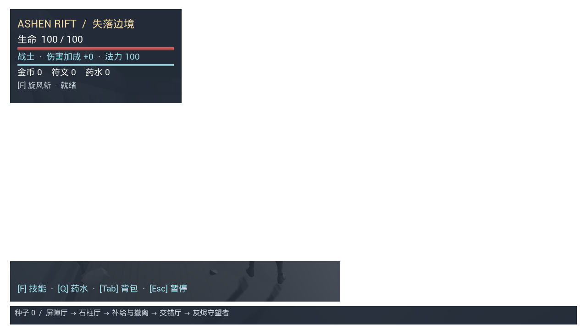
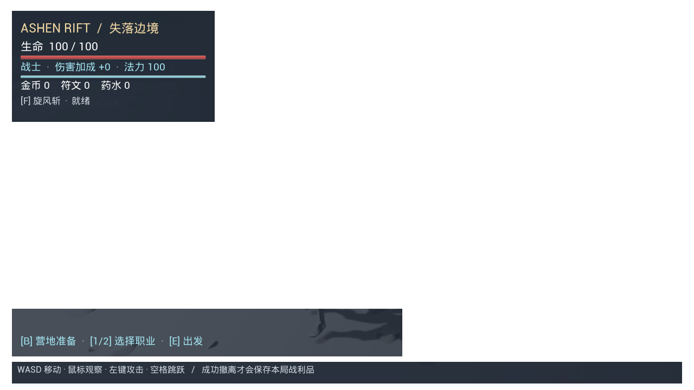

# Ashen Rift: The Lost Frontier

English | [简体中文](README.zh-CN.md)

A single-player action RPG prototype built with **Unreal Engine 4.27.2, C++ and Blueprints**. Explore dungeons, collect loot, buy supplies, and choose between extracting safely or pushing deeper for greater rewards and permanent progression.

**Version:** 0.9 · **Platform:** Windows · **Interface:** Chinese · **Status:** Playable prototype with an integrated environment

[Changelog](CHANGELOG.md) · [Development notes](#development-notes)



## The central decision

Every run asks how much you are willing to risk. Spending run gold on potions and temporary damage upgrades can improve your chances against later enemies, but leaves less gold to extract. At the supply room, you can secure your loot or continue towards an elite enemy and the Ashen Warden for additional gold and runes.

Successful extraction stores remaining items and currency. Runes purchase permanent talents, and stored equipment can be taken into later runs. Bringing stronger gear helps you fight, but that gear is also lost if you die before extracting. Uncarried stash items, banked currency and purchased talents remain safe.

```text
Camp preparation → Combat rooms → Supply room
                                     ├─ Extract → Save loot → Return to camp
                                     └─ Continue → Elite and Boss → Return to extract
```

## Features

- **Two classes:** a melee Warrior with Whirlwind and a ranged Mage with mana-based spells and Arcane Burst.
- **Three enemy types and one Boss:** Raiders, projectile-firing Hexers, heavy-attacking Sentinels and the Ashen Warden, with readable attack warnings and opportunities to dodge or use cover.
- **Shuffled combat layouts:** Pillars, Barricade and Cross change order between runs. Fixed seeds reproduce layout order; the connected main route stays fixed.
- **Teammate environment integration:** Kuangxin's KayKit dungeon map, three editable room Blueprints and a furnished camp are connected to the existing gameplay. The original greybox map remains available.
- **Equipment and economy:** weapon, armour and charm slots, drops, potions, limited shop stock and temporary damage upgrades.
- **Persistent progression:** shared Vitality and Might talents, item storage and camp loadout preparation.
- **Clickable Chinese UI:** main menu, camp, inventory, trader, pause and settlement screens, with keyboard shortcuts retained.
- **Combat feedback:** five basic skeletal overlay animations, hit flashes, sparks, actual damage numbers, light camera feedback and eleven originally synthesised sound effects.



*Screenshots are from version 0.9 environment validation using an isolated test profile. Enemies were cleared for the dungeon navigation check.*

## Requirements

The current Windows build targets explicitly select the following toolchain:

| Component | Version |
|---|---|
| Unreal Engine | 4.27.2 |
| Visual Studio Build Tools | 2019, with C++ build tools |
| MSVC | v142 |
| Windows SDK | 10.0.19041.0 |
| .NET Framework | 4.8 SDK and Targeting Pack |

Python Script Plugin and Editor Scripting Utilities are enabled for editor asset-generation tools. Gameplay does not require a separate Python installation.

## Build and play

Clone the project and open PowerShell in its root directory, which contains `AshenRift.uproject`:

```powershell
git clone https://github.com/Aprine/Ashen-Rift-The-Lost-Frontier.git
cd Ashen-Rift-The-Lost-Frontier
```

Set `$ueRoot` to your **Unreal Engine 4.27.2 installation directory**; the example uses the scripts' default path.

```powershell
$ueRoot = 'D:\Epic Games\UE_4.27'

# Build the editor module.
.\Tools\BuildProject.ps1 -EngineRoot $ueRoot

# Launch a standalone play window using the installed engine.
.\Tools\PlayPrototype.ps1 -EngineRoot $ueRoot
```

Alternatively, open `AshenRift.uproject` in UE 4.27.2 after building and press **Play**. The default map is `/Game/AshenRift/Maps/L_FrontierDungeon`. The preserved version 0.8 greybox is `/Game/AshenRift/Maps/L_RandomDungeon`.

Choose a class in the main menu, enter camp, prepare your equipment or purchase talents, then depart for the dungeon. Mouse buttons and keyboard shortcuts are both supported.

To compile the Development game target:

```powershell
.\Tools\BuildProject.ps1 -EngineRoot $ueRoot -Game
```

The play script uses your local Unreal installation. The Development game executable is an uncooked build; a distributable Windows package has not yet been validated.

## Controls

| Action | Control |
|---|---|
| Move / look | WASD / mouse |
| Jump | Space |
| Basic attack / Mage projectile | Left mouse button |
| Class skill | F |
| Use a potion | Q |
| Interact, trade, depart or extract | E |
| Open inventory | Tab |
| Equip or unequip weapon / armour / charm | Z / X / C |
| Open camp preparation | B, while near camp |
| Select Warrior / Mage | 1 / 2, in camp |
| Upgrade Vitality / Might | T / Y, in camp preparation |
| Select stash item / change carried quantity | Up and Down / Left and Right |
| Buy a potion / damage upgrade | 1 / 2, while trading |
| Return to camp or retry a pending save | R, on the result screen |
| Close a panel, or pause / resume | Esc |
| Toggle sound effects | Main-menu or pause-menu button |

Inventory and trading **do not pause combat**. Opening a panel displays the cursor and blocks movement, camera and attack input. The dedicated pause menu freezes the game world, cooldowns and extraction progress.

In editor Play-in-Editor sessions, Esc may stop play instead of opening the pause menu. Use the standalone window to check pause behaviour; Shift + F1 releases the editor mouse cursor.

## Run and progression rules

- **Extraction:** remain in the blue portal for three seconds. Taking damage or leaving cancels the attempt. Defeating the Boss is optional.
- **Death:** carried items, new loot and unextracted currency are lost. Uncarried stash stock, banked currency and permanent talents remain.
- **Loadouts:** bring at most one of each equipment type and five potions, with a weapon matching your class. Stock is deducted and saved at departure, not while preparing. Selected equipment is automatically equipped on entry.
- **Talents:** Vitality adds maximum health and Might adds damage. Both have three ranks, are shared by the classes and cost banked runes.
- **Currencies:** dungeon shops spend run gold. Banked gold is currently recorded and displayed; permanent upgrades use runes.
- **Settlement:** successful extraction stores remaining carried items and new loot together. Consumed potions are not returned, and repeated settlement requests cannot duplicate rewards.

## Validation

On **6 November 2026**, the default regression configuration passed **eleven automated tests** (three core and eight integration tests); the preserved greybox configuration passed its ten-test suite. Coverage includes health, inventory, room seeds, the run loop, progression, dungeon navigation, camp management, enemy variants, UI, combat feedback and teammate-map integration.

Run the existing suite after building the editor module:

```powershell
.\Tools\TestPrototype.ps1 -EngineRoot $ueRoot
```

The script checks fresh reports and assertion results. Integration tests use isolated save profiles. Logs and reports are generated under `Saved/`, which is excluded from version control.

Version 0.9 adds `Integration.TeamMap` for authored prefab spawning, door clearance, all six layout permutations, camp reuse and extraction/death settlement. The default suite targets the integrated map; select the historical map with `-DungeonMap /Game/AshenRift/Maps/L_RandomDungeon`. Current integration results are recorded in the [map integration notes](Docs/15_Team_Map_Integration.md).

Rendered checks and engine audio-output analysis are documented in the development notes. Player balance studies, performance benchmarks and packaged-build acceptance are still pending.

## Project structure

```text
AshenRift.uproject    Unreal project descriptor
Source/              C++ gameplay, UI, feedback and tests
Content/             Maps, Blueprints, animations, audio and materials
Config/              Project, input and navigation settings
Data/AudioSource/    Synthesised sound-effect source WAV files
Scripts/             Editor setup and asset-generation utilities
Tools/               PowerShell build, play and test scripts
Docs/                Development specifications and version notes
Docs/Images/         Screenshots used by this README
```

`Binaries/`, `Intermediate/`, `DerivedDataCache/` and `Saved/` are generated locally and excluded by `.gitignore`.

Edit or rename Unreal assets through the editor's Content Browser and fix redirectors there. Existing maps and assets are already included. Initialization scripts are development utilities, not required startup steps; avoid regenerating existing levels during normal setup.

## Development notes

Every version update must keep the [English README](README.md), [Chinese README](README.zh-CN.md) and [changelog](CHANGELOG.md) in sync. Project maintenance instructions are recorded in [AGENTS.md](AGENTS.md).

Detailed notes are currently written in Chinese. Older entries describe historical versions; use the newest applicable entry for current behaviour.

| Topic | Documentation |
|---|---|
| Version 0.9 teammate environment integration | [Map integration](Docs/15_Team_Map_Integration.md) |
| Editing room and camp Blueprints | [Room layouts](Docs/13_Editable_Room_Layouts.md) / [Camp layout](Docs/14_Camp_Room_Blueprint.md) |
| Environment asset provenance and license | [Third-party assets](Docs/ThirdPartyAssets.md) |
| Version 0.8 animations, effects and audio | [Combat feedback](Docs/12_Combat_Feedback.md) |
| Version 0.7 UMG and input behaviour | [Chinese interface](Docs/11_Chinese_UMG.md) |
| Version 0.6 ranged and elite enemies | [Enemy variants](Docs/10_Enemy_Variants.md) |
| Version 0.5 talents, stash and departure transactions | [Camp and progression](Docs/09_Camp_Talents_Stash.md) |
| Version 0.4 layouts, navigation and equipment | [Random dungeon and equipment](Docs/08_Random_Dungeon_Equipment.md) |
| Classes, trader and Boss | [Progression prototype](Docs/07_Progression_Prototype.md) |
| Manual acceptance scenarios | [Acceptance checklist](Docs/03_Acceptance.md) |
| Sound-effect sources | [Audio sources](Data/AudioSource/README.md) |

## Current limitations and next steps

- The integrated environment uses KayKit assets and retains some greybox support geometry. Characters and weapons still use template or simple placeholder visuals. Some scene signs remain in English.
- Layout order varies, but the main route has no procedural branches or maze topology.
- Combat animations are basic generated overlays. Damage still uses existing gameplay timing rather than animation-driven hit events.
- The stash has a fixed item list without item instances, random affixes, crafting or insurance.
- Sound settings currently provide a session-level on/off toggle. Background music, volume sliders and final mixing remain future work.
- Navigation can briefly pause while updating, and enemies can obstruct one another.
- The UI has been checked at 1280 × 720. Broad resolution coverage, controller navigation, performance benchmarks and final Windows packaging remain to be completed.

The next stage focuses on playtesting preparation–spending–extraction decisions, balancing rewards and difficulty, refining combat presentation, and validating a packaged build.

## Credits

Developed as a **COMP 4900SEF Group 23** course project.

- The starting character, movement animations and template dependencies come from Epic Games' Unreal Engine Third Person template.
- [Kuangxin's contributed map](https://github.com/kuangxin114514/Ashen-Rift-The-Lost-Frontier/commit/e2dfc0b83847e912f477b9bc0ecd9c0046c2f729) supplies the dungeon environment and editable room/camp layouts. KayKit environment assets are by [Kay Lousberg](https://kaylousberg.itch.io/kaykit-dungeon-pack), under CC0; see [asset provenance](Docs/ThirdPartyAssets.md).
- The five basic combat overlay animations and eleven synthesised sound effects were generated for this project. Audio source files and the generation script are included.
- Diablo, Path of Exile and Hades provided design inspiration.

No project-wide open-source license is currently specified.
