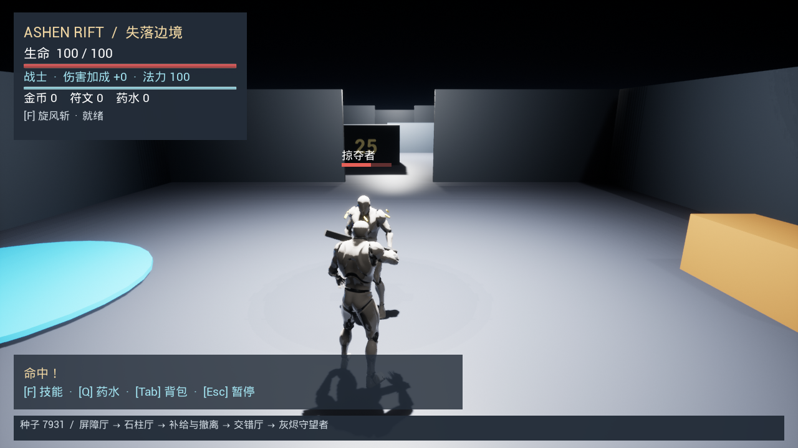
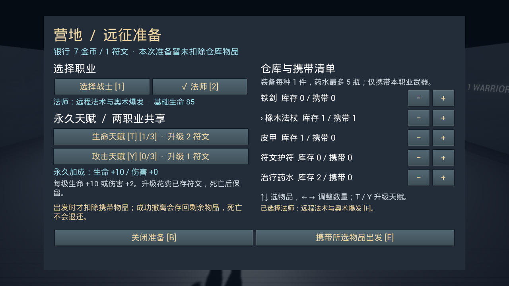

# Ashen Rift：失落边境

[English](README.md) | 简体中文

一款使用 **Unreal Engine 4.27.2、C++ 和蓝图**开发的单人动作 RPG 原型。探索地牢、收集战利品、购买补给，并在安全撤离与继续深入、争取更多奖励和永久成长之间作出选择。

**版本：**0.8 · **平台：**Windows · **界面语言：**中文 · **开发状态：**可玩的灰盒原型

[更新日志](CHANGELOG.md) · [开发记录](#开发记录)



## 核心决策

每一局都需要决定愿意承担多大风险。使用本局金币购买药水和临时伤害强化，可以提高应对后续敌人的能力，但也会减少能够撤离带出的金币。在补给房，你可以保住已有战利品，也可以继续挑战精英敌人和灰烬守望者，争取额外的金币与符文。

成功撤离会保存剩余物品和货币。符文用于购买永久天赋，已存入仓库的装备可以在后续副本中携带。更好的装备有助于战斗，但在撤离前死亡也会失去这些装备。未携带的仓库物品、已存货币和已购买的天赋会保留。

```text
营地准备 → 战斗房间 → 补给房
                       ├─ 撤离 → 保存战利品 → 返回营地
                       └─ 继续 → 精英与 Boss → 返回撤离点
```

## 功能特色

- **两种职业：**拥有旋风斩的近战战士，以及使用法力施放法术和奥术爆发的远程法师。
- **三种敌人及一名 Boss：**掠夺者、发射弹体的术士、使用重击的精英守卫，以及灰烬守望者；攻击具有清晰预警，玩家可以闪避或利用掩体应对。
- **随机排列的战斗布局：**Pillars、Barricade 和 Cross 在不同副本中的顺序会变化。固定种子可复现布局顺序，连通的主路线保持固定。
- **装备与经济系统：**武器、护甲和饰品槽位，以及物品掉落、药水、有限商店库存和临时伤害强化。
- **跨局成长：**两职业共享的生命与攻击天赋、物品仓库和营地携装准备。
- **可点击的中文界面：**主菜单、营地、背包、商店、暂停和结算界面，同时保留键盘快捷键。
- **战斗反馈：**五段基础骨骼叠加动画、受击闪烁、火花、实际伤害数字、轻微镜头反馈，以及十一个原创合成音效。



*截图取自原型验证。画面中的库存与余额来自测试档案。*

## 环境要求

当前 Windows 构建目标明确指定以下工具链：

| 组件 | 版本 |
|---|---|
| Unreal Engine | 4.27.2 |
| Visual Studio Build Tools | 2019，包含 C++ 构建工具 |
| MSVC | v142 |
| Windows SDK | 10.0.19041.0 |
| .NET Framework | 4.8 SDK 和 Targeting Pack |

项目为编辑器资产生成工具启用了 Python Script Plugin 和 Editor Scripting Utilities。游戏运行不需要单独安装 Python。

## 构建与游玩

克隆项目，然后在包含 `AshenRift.uproject` 的项目根目录打开 PowerShell：

```powershell
git clone https://github.com/Aprine/Ashen-Rift-The-Lost-Frontier.git
cd Ashen-Rift-The-Lost-Frontier
```

将 `$ueRoot` 设置为本机的 **Unreal Engine 4.27.2 安装目录**；下面的示例使用脚本的默认路径。

```powershell
$ueRoot = 'D:\Epic Games\UE_4.27'

# 编译编辑器模块。
.\Tools\BuildProject.ps1 -EngineRoot $ueRoot

# 使用已安装的引擎启动独立试玩窗口。
.\Tools\PlayPrototype.ps1 -EngineRoot $ueRoot
```

也可以在构建完成后，使用 UE 4.27.2 打开 `AshenRift.uproject` 并点击 **Play**。默认地图为 `/Game/AshenRift/Maps/L_RandomDungeon`。

在主菜单选择职业，进入营地，准备装备或购买天赋，然后出发进入地牢。鼠标按钮和键盘快捷键均可使用。

编译 Development 游戏目标：

```powershell
.\Tools\BuildProject.ps1 -EngineRoot $ueRoot -Game
```

试玩脚本使用本机安装的 Unreal Engine。Development 游戏可执行文件属于未烘焙构建；可分发的 Windows 打包版本尚未完成验证。

## 操作说明

| 操作 | 按键或控件 |
|---|---|
| 移动／观察 | WASD／鼠标 |
| 跳跃 | 空格 |
| 普通攻击／法师弹体 | 鼠标左键 |
| 职业技能 | F |
| 使用药水 | Q |
| 交互、交易、出发或撤离 | E |
| 打开背包 | Tab |
| 装卸武器／护甲／饰品 | Z／X／C |
| 打开营地准备 | 营地附近按 B |
| 选择战士／法师 | 营地中按 1／2 |
| 升级生命／攻击天赋 | 营地准备界面中按 T／Y |
| 选择仓库物品／调整携带数量 | 上、下方向键／左、右方向键 |
| 购买药水／伤害强化 | 交易时按 1／2 |
| 返回营地或重试待完成的存档 | 结算界面中按 R |
| 关闭面板，或暂停／继续 | Esc |
| 开关音效 | 主菜单或暂停菜单按钮 |

背包和交易**不会暂停战斗**。打开面板会显示鼠标，并阻止移动、视角和攻击输入。专门的暂停菜单会冻结游戏世界、冷却和撤离进度。

在编辑器的 Play-in-Editor 试玩中，Esc 可能会停止试玩，而不是打开暂停菜单。请在独立窗口中检查暂停行为；Shift + F1 可释放编辑器中的鼠标。

## 副本与成长规则

- **撤离：**在蓝色传送阵内停留三秒。受伤或离开会取消撤离。击败 Boss 不是撤离的必要条件。
- **死亡：**携带物品、新战利品和未带出的货币都会损失。未携带的仓库库存、已存货币和永久天赋保留。
- **携装：**每种装备最多携带一件，药水最多五瓶，武器必须符合当前职业。库存会在出发时扣除并保存，准备选择时不扣除。选中的装备会在入场时自动装备。
- **天赋：**生命天赋提高最大生命值，攻击天赋提高伤害。两种天赋均有三级，由两个职业共享，消耗已存符文购买。
- **货币：**副本商店使用本局金币。已存金币目前只记录和展示；永久升级使用符文。
- **结算：**成功撤离会将剩余携带物品与新战利品一并存入仓库。已经消耗的药水不会返还，重复结算请求也不会复制奖励。

## 验证情况

记录于 **2026 年 11 月 3 日**的回归测试通过了**十项自动化测试**：三项核心测试和七项集成测试。覆盖生命值、背包、房间种子、副本循环、成长系统、随机地牢、营地管理、敌人变种、界面和战斗反馈。

编译编辑器模块后，运行现有测试套件：

```powershell
.\Tools\TestPrototype.ps1 -EngineRoot $ueRoot
```

脚本会检查新生成的报告及断言结果。集成测试使用独立存档。日志和报告生成在 `Saved/` 中，该目录不纳入版本控制。

渲染检查和引擎音频输出分析记录在开发文档中。玩家平衡性研究、性能基准测试和打包版本验收仍待完成。

## 项目结构

```text
AshenRift.uproject    Unreal 项目描述文件
Source/              C++ 玩法、界面、反馈与测试
Content/             地图、蓝图、动画、音频和材质
Config/              项目、输入和导航配置
Data/AudioSource/    合成音效的源 WAV 文件
Scripts/             编辑器初始化与资产生成工具
Tools/               PowerShell 构建、试玩与测试脚本
Docs/                开发规格和版本记录
Docs/Images/         本 README 使用的截图
```

`Binaries/`、`Intermediate/`、`DerivedDataCache/` 和 `Saved/` 均在本机生成，并由 `.gitignore` 排除。

请在编辑器的 Content Browser 中编辑或重命名 Unreal 资产，并在其中修复重定向器。项目已包含现有地图和资产。初始化脚本属于开发工具，不是必要的启动步骤；正常配置项目时应避免重新生成现有关卡。

## 开发记录

每次版本更新都必须同步维护[英文 README](README.md)、[中文版 README](README.zh-CN.md)和[更新日志](CHANGELOG.md)。项目维护规则记录在 [AGENTS.md](AGENTS.md) 中。

详细记录目前使用中文编写。较早的条目描述历史版本；查询当前行为时，请使用适用的最新条目。

| 主题 | 文档 |
|---|---|
| 0.8 版动画、特效与音频 | [战斗反馈](Docs/12_Combat_Feedback.md) |
| 0.7 版 UMG 与输入行为 | [中文界面](Docs/11_Chinese_UMG.md) |
| 0.6 版远程敌人与精英 | [敌人变种](Docs/10_Enemy_Variants.md) |
| 0.5 版天赋、仓库与出发事务 | [营地与成长](Docs/09_Camp_Talents_Stash.md) |
| 0.4 版布局、导航与装备 | [随机地牢与装备](Docs/08_Random_Dungeon_Equipment.md) |
| 职业、商店与 Boss | [成长原型](Docs/07_Progression_Prototype.md) |
| 手动验收场景 | [验收清单](Docs/03_Acceptance.md) |
| 音效源文件 | [音频源文件](Data/AudioSource/README.md) |

## 当前限制与下一步计划

- 环境、角色和武器仍使用灰盒、模板或简易占位外观。部分场景标牌仍为英文。
- 布局顺序会变化，但主路线没有随机分支或迷宫拓扑。
- 战斗动画为基础生成的叠加动画。伤害仍使用现有玩法时序，而非动画驱动的命中事件。
- 仓库使用固定物品列表，没有独立物品实例、随机词缀、合成或保险。
- 音效设置目前提供本次运行内有效的开关。背景音乐、音量滑块和最终混音仍待制作。
- 导航更新时可能短暂停顿，敌人也可能相互阻挡。
- 界面已在 1280 × 720 下检查。更多分辨率、手柄导航、性能基准测试和最终 Windows 打包仍待完成。

下一阶段将重点试玩验证准备—消费—撤离决策、平衡奖励与难度、打磨战斗表现，并验收打包版本。

## 致谢

本项目为 **COMP 4900SEF 第 23 组**课程项目。

- 初始角色、移动动画和模板依赖来自 Epic Games 的 Unreal Engine 第三人称模板。
- 五段基础战斗叠加动画和十一个合成音效为本项目生成。仓库包含音频源文件和生成脚本。
- Diablo、Path of Exile 和 Hades 提供了设计灵感。

目前尚未指定适用于整个项目的开源许可证。
